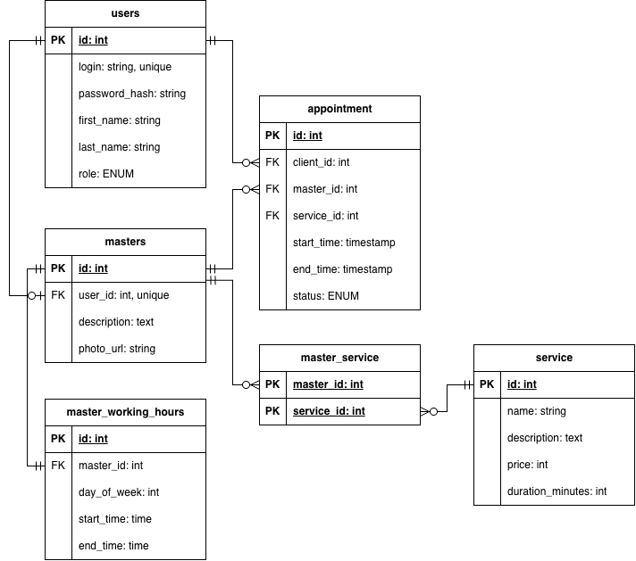

# Модель данных

## Таблицы

### `users`

Учётные записи клиентов, мастеров и администраторов.

| Поле | Тип | Назначение |
| --- | --- | --- |
| `id` | `int` | Первичный ключ. |
| `login` | `string` | Уникальный логин. |
| `password_hash` | `string` | Хеш пароля. |
| `first_name` | `string` | Имя пользователя. |
| `last_name` | `string` | Фамилия пользователя. |
| `role` | `ENUM` | Роль пользователя. |

### `masters`

Профили мастеров, связанные с их учётными записями.

| Поле | Тип | Назначение |
| --- | --- | --- |
| `id` | `int` | Первичный ключ. |
| `user_id` | `int` | Уникальный внешний ключ на `users.id`. |
| `description` | `text` | Описание мастера. |
| `photo_url` | `string` | URL фотографии мастера. |

### `appointment`

Записи клиентов на услуги к мастерам.

| Поле | Тип | Назначение |
| --- | --- | --- |
| `id` | `int` | Первичный ключ. |
| `client_id` | `int` | Внешний ключ на `users.id` клиента. |
| `master_id` | `int` | Внешний ключ на `masters.id`. |
| `service_id` | `int` | Внешний ключ на `service.id`. |
| `start_time` | `timestamp` | Дата и время начала записи. |
| `end_time` | `timestamp` | Дата и время окончания записи. |
| `status` | `ENUM` | Статус записи. |

### `master_service`

Связь многие ко многим между мастерами и услугами. Пара полей образует составной первичный ключ.

| Поле | Тип | Назначение |
| --- | --- | --- |
| `master_id` | `int` | Часть первичного ключа, идентификатор мастера из `masters`. |
| `service_id` | `int` | Часть первичного ключа, идентификатор услуги из `service`. |

### `service`

Каталог услуг салона.

| Поле | Тип | Назначение |
| --- | --- | --- |
| `id` | `int` | Первичный ключ. |
| `name` | `string` | Название услуги. |
| `description` | `text` | Описание услуги. |
| `price` | `int` | Стоимость услуги. |
| `duration_minutes` | `int` | Длительность услуги в минутах. |

### `master_working_hours`

Рабочие интервалы мастеров по дням недели.

| Поле | Тип | Назначение |
| --- | --- | --- |
| `id` | `int` | Первичный ключ. |
| `master_id` | `int` | Внешний ключ на `masters.id`. |
| `day_of_week` | `int` | День недели. |
| `start_time` | `time` | Время начала рабочего интервала. |
| `end_time` | `time` | Время окончания рабочего интервала. |

## Значения ENUM

### `users.role`

- `client` — клиент, который записывается на услуги и управляет своими записями.
- `master` — мастер с профилем в `masters`, который оказывает услуги и просматривает своё расписание.
- `admin` — администратор, который управляет услугами, мастерами и записями салона.

### `appointment.status`

- `planned` — запись создана, посещение запланировано.
- `completed` — услуга оказана.
- `cancelled` — запись отменена, забронированное время освобождено.

Новая запись получает статус `planned`. После оказания услуги она переходит в `completed`, а при отмене — в `cancelled`. Оба статуса конечные.
